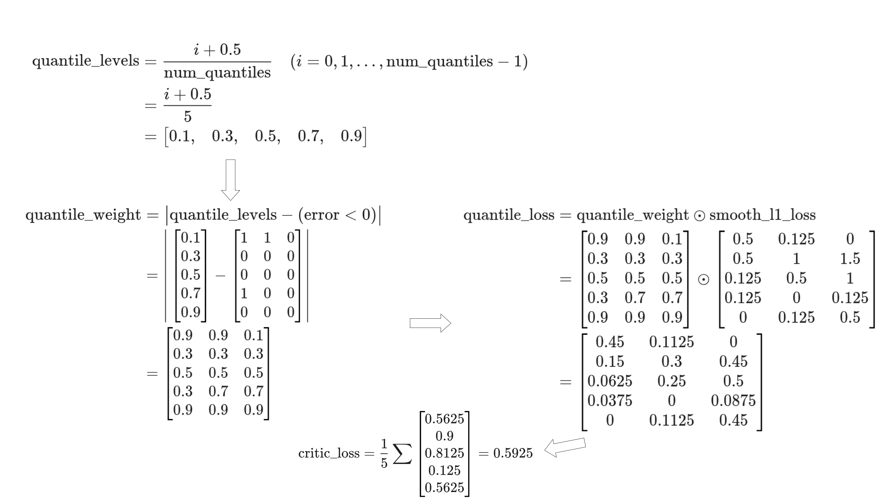

# Under-Construction

## Critic Loss
The initial numbers before calculating the error are just set randomly for the example.

1. Sort `next_quantiles` in ascending order, truncate the top few, and input it into the TD equation to get `target_quantiles`, with `pred_quantiles` ready as well.
2. Because of truncation, `target_quantiles` and `pred_quantiles` have different numbers of elements, but subtract by automatically matching their shapes, then each element of one array meets each element of the other.
3. Although averaging all the error elements works as a loss, doing so ends up matching the median of `target_quantiles`, losing the meaning of quantiles. So for the next step, smooth L1 loss is applied, smoothing out the sharp L1 graph to make it differentiable, which results in smaller values overall. This is applied so that when the error is large, it avoids being affected by extreme values without squaring the error like L2 loss, and when the error is small, it makes the values even smaller to weaken the critic's update intensity so it can learn the quantiles more precisely.

4. To make 'pred_quantiles' predict smaller values at the front and larger values at the back in its array, create `quantile_levels` so that each element represents a quantile level.
5. Here is the core part.  If error > 0, it means underestimation and (error < 0) becomes 0 and the order of `quantile_levels` stays the same. Because it is underestimation, values at the front get a smaller weight so that they are adjusted less, and values at the back get a larger weight so that they are adjusted more. On the other hand, if error < 0, it means overestimation and (error < 0) becomes 1 and the order of `quantile_levels` flips. Because it is overestimation, values at the front get a larger weight so that they are adjusted more, and values at the back get a smaller weight so that they are adjusted less.
6. Finally, multiply `quantile_weight` and `smooth_l1_loss` element-wise, and take the mean to get a scalar that becomes the critic loss.
7. Assuming the critic predicts the quantiles properly, in the actor loss, instead of picking the smallest value, take the mean and use it to update the actor. This is how it avoids overestimation while also avoiding underestimation. There is no truncation in the actor loss procedure because the critic's output has already learned truncation.

