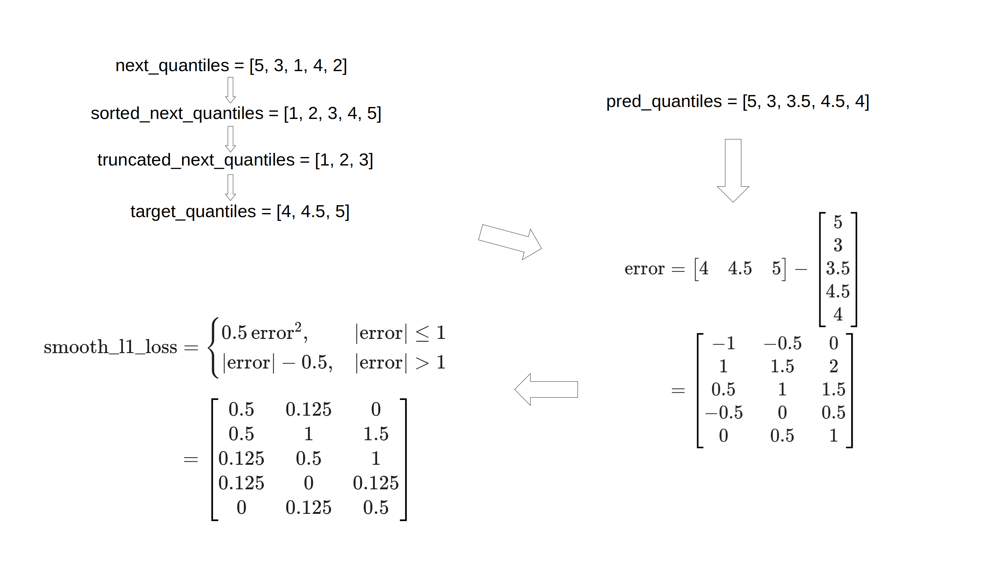

# Under-Construction
Although SAC has become one of the standard algorithms for continuous action control, it suffers from over- and underestimation in the critic's prediction, which slow down learning and limit best performance. For example, even when two critics independently estimate values and take the minimum to mitigate overestimation, selecting the smaller value still results in overestimation if both estimates are overestimated, and still results in underestimation if both are underestimated. So, this approach has limitations in preventing both, and TQC (Truncated Quantile Critics)  was introduced to solve these limitations. Instead of predicting a single value, multiple critics predict values corresponding to quantiles, and then

## Critic Loss
The initial numbers before calculating the error are just set randomly for the example.

1. Sort `next_quantiles` in ascending order, truncate the top few, and input it into the TD equation to get `target_quantiles`, with `pred_quantiles` ready as well.
2. Because of truncation, `target_quantiles` and `pred_quantiles` have different numbers of elements, but subtract by automatically matching their shapes, then each element of one array meets each element of the other.
3. Although averaging all the error elements works as a loss, doing so ends up matching the median of `target_quantiles`, which is no different from predicting just one value and losing the meaning of quantiles. So for the next step, smooth L1 loss is applied, smoothing out the sharp L1 graph to make it differentiable, which results in smaller values overall. This is applied so that when the error is large, it avoids being affected by extreme values without squaring the error like L2 loss, and when the error is small, it makes the values even smaller to weaken the critic's update intensity so it can learn the quantiles more precisely.

4. To make `pred_quantiles` predict smaller values at the front and larger values at the back in its array, create `quantile_levels` so that each element represents a quantile level.
5. Here is the core part.  If error > 0, it means underestimation and (error < 0) becomes 0 and the order of `quantile_levels` stays the same. Because it is underestimation, values at the front get a smaller weight so that they are adjusted less, and values at the back get a larger weight so that they are adjusted more. On the other hand, if error < 0, it means overestimation and (error < 0) becomes 1 and the order of `quantile_levels` flips. Because it is overestimation, values at the front get a larger weight so that they are adjusted more, and values at the back get a smaller weight so that they are adjusted less.
6. Finally, multiply `quantile_weight` and `smooth_l1_loss` element-wise, sum horizontally first and then take the mean vertically to get a scalar that becomes the critic loss. It is important not to just take the mean of entire elements because the number of quantiles is repeatedly added up unnecessarily, weakening the learning signal.
7. Assuming the critic predicts the quantiles properly, in the actor loss, instead of picking the smallest value, take the mean and use it to update the actor. This is how it avoids overestimation while also avoiding underestimation. There is no truncation in the actor loss procedure because the critic's output has already learned truncation.

### Automatic Adjustment of Dropped Quantiles
There are papers that show some ways to automatically adjust TQC's `top_quantiles_to_drop`, such as comparing actual return with the critic's prediction. However, I came up with a simpler idea to adjust it: comparing the counts of 0s and 1s from evaluating (error < 0). If there are more 1s than 0s, it means overestimation, so `top_quantiles_to_drop`+1 to decrease the critic's prediction value. If there are more 0s than 1s, it means underestimation, so `top_quantiles_to_drop`-1 to increase the critic's prediction value.

I set the adjustment period to every update, set `min_drop` and `max_drop` to prevent excessive adjustment, and ran experiments on HalfCheetah-v5 with all random seeds fixed. In max 100,000 steps, both SAC and TQC (fixed drop of 6) achieved over a reward of 6,000 near the end, while TQC (automatic adjustment) showed larger reward fluctuations in the early stages—maybe because of adjusting on every step—achieved over 6,000 faster and reached higher than them.

These results prove that adjusting `top_quantiles_to_drop` is better than a fixed drop when overestimation or underestimation occurs. I think the reason adjusting on every step leads to fluctuations is that the target criterion of the critic keeps shifting while its predictions are messy early on, and it did not collapse because rewards kept increasing even with fluctuations.

## Training Progress

## Conclusion
